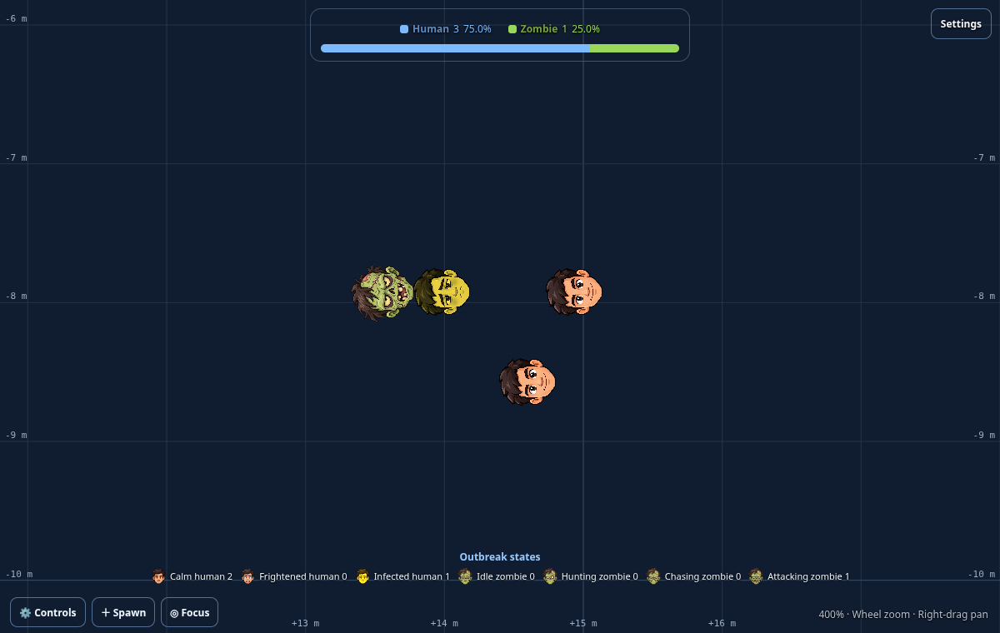

# Dev.8 arena controls, pursuit and Outbreak

Use **Controls → Movement** to switch CPU or GPU steering during a round. WebGPU computes headings and movement directions for creatures on and off screen. The CPU continues to choose targets, integrate positions, resolve contacts and process conversions. New steering decisions and speed-sensitive wall turns can be resolved on the CPU within the same tick. Loss of a GPU device resumes CPU movement in the same round.

**Offscreen creature collisions** defaults to off. Creatures keep moving and respecting walls. Bites and conversions still work offscreen. Enable the checkbox for full physical separation between offscreen creatures. New Round and reload remember the wall rectangle, border, width and boundary mode per game mode. An explicit change to the next-round arena size generates a new rectangle. If a requested population exceeds available spawning space, the arena reports its capacity.

The total population limit is **999,999** and the speed slider reaches **100×**. The Spawn panel includes creatures per burst, spawn interval, spread and optional mass spawn on click or tap.

## Behavior

- Classic and RPSLS hunters evade predators within the danger radius and predators blocking the path to prey. Sight and hearing apply when FOV is enabled. A hunter fleeing head-on danger turns away immediately.
- A competing prey must beat the configured distance improvement and remain closer for **350 ms** by default. Change the duration in Settings → Movement. A lost or converted target can be replaced immediately.
- Zombies start idle. Detecting a human by sight or hearing starts a chase. Seeing a hunting, chasing or attacking zombie wakes another idle zombie into hunting. Once active, a zombie keeps hunting between chases and attacks.
- Infected humans remain prey until they turn. Continued bite contact earns incubation reductions at the configured interval. Converted zombies start idle and acquire their own target.
- Infected faces have a yellow tint and zoomed-out infected markers are yellow. The state legend uses full names.

## Layout and configuration

Overlay backgrounds start at **100% transparency**. Settings → Interface controls the background slider, Move overlays and Reset overlay positions. Drag visible overlays with a mouse or touch. The settings window also moves by its header.

Settings → Data & Storage exports and imports all registered preferences, including all modes, wall bounds, camera, overlay layout and lab controls. The export uses the same JSON format as [default.config.json](default.config.json). Replace that file under the deployed dev directory to supply site defaults. Saved personal settings override site defaults.

## Verified limits

Chrome Headless Shell 151 on Linux, SwiftShader software WebGPU, 1200 × 760 viewport. A 9,999-human main-arena run at a 1× target achieved 0.86× across a two-second sample. A separate 999,999-human run with an enlarged arena and a 100× target achieved 0.019× across the measured interval. Both samples used peaceful humans and offscreen collision skipping. Hardware GPU throughput and million-agent active outbreak performance remain unmeasured.

The main browser integration exercises hot switching, movement on the GPU during an active outbreak, GPU loss and missing-adapter recovery, both offscreen physics solvers, walls across restart and reload, overlay drag/reset, JSON export/import and fresh site defaults, repeated bites, pack activation, and mass spawning. Gameplay regression tests cover RPS/RPSLS threat priority with FOV on and off and the prey-switch timer.
