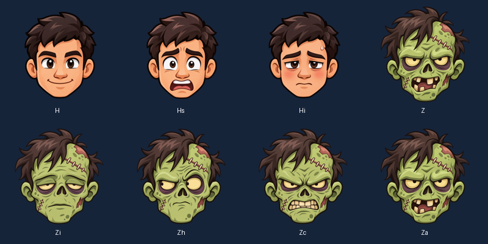

# Classic artwork inventory

Original commit `fef8bfcec10d00a1dfa97663313c16969e675db7` of `Azotorp/RockPaperScissorsBattle`. The eight original PNGs remain under `assets/`. Each corresponding theme copy has the same SHA-256 digest. All faces point chin-down in their source canvases.

| Classic PNG | States | Canvas | Alpha range | Source | SHA-256 |
|---|---|---|---|---|---|
| `creatures/Hi.png` | Hi | 1254 × 1254 | (0, 255) | Expression edit of original human, fitted to the reference canvas | `28df5a1cdfe6bf436a6decc10b15344cf697e5888b503db868f1ffed00122c9b` |
| `creatures/Zc.png` | Zc | 1254 × 1254 | (0, 255) | Expression edit of original zombie, fitted to the reference canvas | `af428f3c40dc0dd7206805a64fa3c29f15c1429ad18eeda6c1321be25ab9b1d2` |
| `creatures/Zh.png` | Zh | 1254 × 1254 | (0, 255) | Expression edit of original zombie, fitted to the reference canvas | `bf7e5552c06663ae60922ace8cedf6883bf8eb3a1fb4f20445777484f682717f` |
| `creatures/Zi.png` | Zi | 1254 × 1254 | (0, 255) | Expression edit of original zombie, fitted to the reference canvas | `4fe3f3938f58019832c182662e2eae4f5aeaa65a6c1b1ec862967fd24fe50c17` |
| `creatures/human-scared.png` | Hs | 1254 × 1254 | (0, 255) | Original `assets/human-scared.png` | `857b5547ba03ac6213f9b4c12db6d73f0bd91760201717401040ab23b6153a81` |
| `creatures/human.png` | H | 1254 × 1254 | (0, 255) | Original `assets/human.png` | `73587e001d8a4b04009989a2c6051e85df7ab7dc6293db8c494be158aab5b079` |
| `creatures/lizard.png` | L | 393 × 352 | (0, 255) | Original `assets/lizard.png` | `718b994846e78c14e62c27df616aa0dd28648997fb50dd3cf0c88521ff491ab6` |
| `creatures/paper.png` | P | 361 × 437 | (0, 255) | Original `assets/paper.png` | `2f0797f7149ea20a684274fd053b4cf9f1883fc0b5e7745235271614020d1721` |
| `creatures/rock.png` | R | 411 × 374 | (0, 255) | Original `assets/rock.png` | `3234e4536a49f695c7c2f6c122d38323a7ccc34da4bfb15f82128cdeed45753b` |
| `creatures/scissors.png` | Sc | 406 × 458 | (0, 255) | Original `assets/scissors.png` | `2097dd1ecec418488edb1a8d18581e38c2921d25c99e38c00b1ac05f983cedeb` |
| `creatures/spock.png` | Sp | 395 × 464 | (0, 255) | Original `assets/spock.png` | `fd9df2ad87cd23724c7a7de453658fc59962ed17e9e4ffd0caa3d1ee6fa5ca4b` |
| `creatures/zombie.png` | Z, Za | 1254 × 1254 | (0, 255) | Original `assets/zombie.png` | `973274002231ebda99dbb37376ed776d9c88a9568e71d8ec3e004d4a29997e7e` |

Z and Za share the original bared-teeth, open-jaw zombie. Each expression uses one static PNG. The contact sheet shows all eight human and zombie state assignments.

